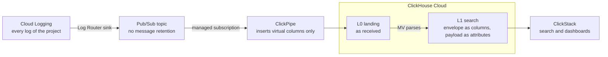

<div align="center">

# Google Cloud Logging → ClickHouse Cloud

**Stream every Cloud Logging entry into ClickHouse Cloud with Pub/Sub ClickPipes, and search it in ClickStack.**

[](https://tkykenmt-at-ch.github.io/sample-google-cloud-logging-to-clickhouse/)
[](LICENSE)
[](https://clickhouse.com/cloud)
[](terraform/)
[](docs/en/findings.md)

English · [日本語](README.ja.md)


</div>

> [!NOTE]
> Pub/Sub ClickPipes was in Private Preview when this was tested (2026-10), and its behavior may change.
> The main behavior was observed on real services; dates, versions, conditions, numbers and untested items are in the [findings](docs/en/findings.md).
> Repeat the checks in the [hands-on](docs/en/hands-on.md) before adopting it.

## Highlights

- **No agents to run.** A Log Router sink publishes to Pub/Sub, and a ClickPipe inserts into ClickHouse Cloud.
- **Replayable.** L0 keeps each LogEntry as delivered, so the search tables can be rebuilt with SQL.
- **Ready for ClickStack.** L1 holds the envelope as columns and the payload as attributes, so ClickStack search and dashboards work on it directly.
- **Japanese full-text search.** `Body` has a 2-character n-gram text index; a word tokenizer silently finds nothing in Japanese text.
- **Terraform or the console.** One Terraform configuration with plan-only tests, or the same build by hand in the browser, with screenshots. ClickPipes authenticates with a service account key or Workload Identity.
- **Try it on your laptop first.** `verify/local_e2e.sh` runs the whole SQL set on `clickhouse local`.

## Architecture



Materialized views (MVs) parse and shape the ingested logs.

| Layer | Required | Contents |
|---|---|---|
| L0 | Yes | The LogEntry as delivered. Source for rebuilding L1 and L2 |
| L1 | Yes | The envelope (time, severity, log name, resource, trace, main HTTP fields) as columns, the payload as attributes. Start every search, extraction, and dashboard here |
| L2 | No | A typed table for one kind of log. Only when L1 cannot meet a requirement |
| L3 | No | Aggregates, for long-range trends or keeping aggregates longer than rows |

How the tables and MVs connect, and their columns, are in "Overview" and "Table definitions" of [Design](docs/en/design.md).

## Quick start

Check the whole SQL set locally without creating any cloud resources (needs `clickhouse` and `python3`):

```bash
verify/local_e2e.sh 20000
```

It prints a table that reconciles row counts across L0, L1, L2, L3, and the noise counts, and compares Japanese full-text search with LIKE.

To deploy to real services, follow [Setup](docs/en/setup.md) and use Terraform.
To build the pieces one at a time with gcloud and clickhousectl and see what each does, follow part 3 of the [Hands-on](docs/en/hands-on.md).

> [!WARNING]
> From `terraform apply` on, the sink sends every log of the project to Pub/Sub, which is billed.
> Read "Before you start" in [Setup](docs/en/setup.md) first, and try it in a test project.

## Documents

The same documents are also on the [docs site](https://tkykenmt-at-ch.github.io/sample-google-cloud-logging-to-clickhouse/), with search.

| Document | Contents |
|---|---|
| [Design](docs/en/design.md) | Key points, layer roles, when to build an L2, cost estimation, decisions for your environment, design details |
| [Setup](docs/en/setup.md) | Cautions before you start, deploying with Terraform, changing settings, removal |
| [Setup in the browser](docs/en/setup-console.md) | Without Terraform: the same configuration built only in the Google Cloud and ClickHouse Cloud consoles, with screenshots |
| [Hands-on](docs/en/hands-on.md) | Part 1 runs the SQL on a local `clickhouse local`; part 2 deploys to real services with Terraform and searches in ClickStack; part 3 builds the same pieces one at a time with gcloud and clickhousectl |
| [Operations](docs/en/operations.md) | Daily checks, noise rules, L2 and L3, MV failures, operations to avoid, retention, switching production logs, rebuilding L0 and L1 (appendix) |
| [Findings](docs/en/findings.md) | Observed behavior and measurements |

<details>
<summary><b>Repository layout</b></summary>

| Path | Contents |
|---|---|
| `terraform/` | Topic, sink, IAM, ClickPipes service account, tables and MVs (runs `sql/`), ClickPipe, ClickStack source and dashboard. `terraform/tests/` has plan-only tests (`terraform test`, no credentials) |
| `sql/` | DDL for L0, L1, MV1, L3 (per-minute counts) and noise counts. `{{VAR}}` is replaced when applied |
| `sql/examples/` | Optional L2 examples (audit logs, GKE upgrade notifications) |
| `sql/runbooks/` | SQL templates per kind of change |
| `loadgen/gen_logentry.py` | Synthetic LogEntry generator and Pub/Sub publisher (standard library only) |
| `verify/local_e2e.sh` | End-to-end check of the SQL on a local ClickHouse |
| `verify/completeness.sh` | Reconciles every published message ID with L0 and L1 |
| `verify/checks.sql` | Periodic checks: latency, stuck batches, duplicates, late arrivals, parser health |
| `tools/chq.py` | Runs SQL files one statement at a time through `clickhousectl cloud service query` |
| `tools/wait_subscriptions_gone.py` | Waits until ClickPipes has deleted its managed subscription (used by `terraform destroy`) |
| `mkdocs.yml`, `tools/mkdocs/` | Docs site built from `docs/` and the README, published to GitHub Pages by `.github/workflows/pages.yml` |

</details>

## Out of scope

- Mapping Logs Explorer features to ClickStack features
- Sizing pipes and services for a given volume (the load tests in the findings are small)
- Changing the `_Default` bucket sink (moving production logs over follows your own change process)

## License

Apache License 2.0. See [LICENSE](LICENSE).
